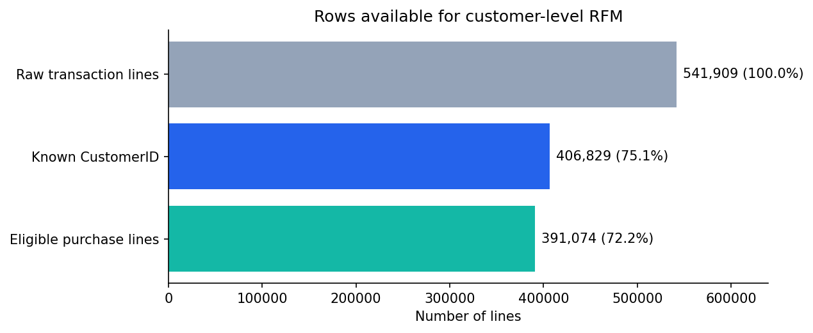
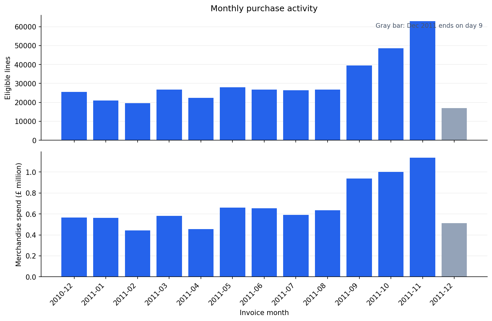
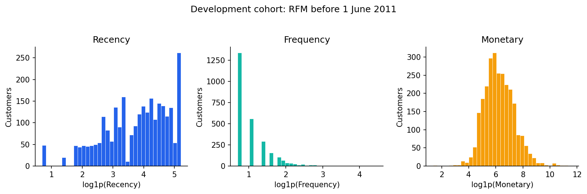
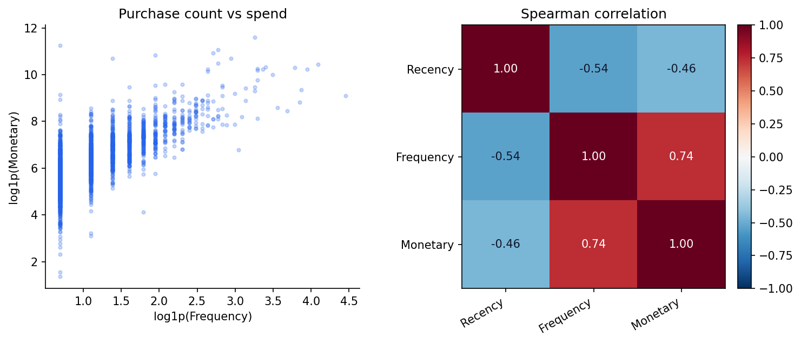
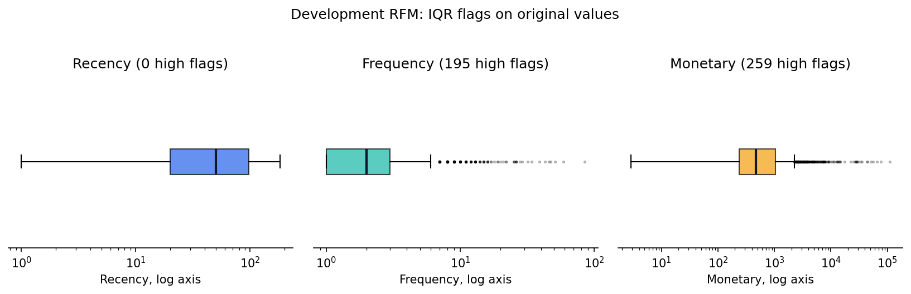
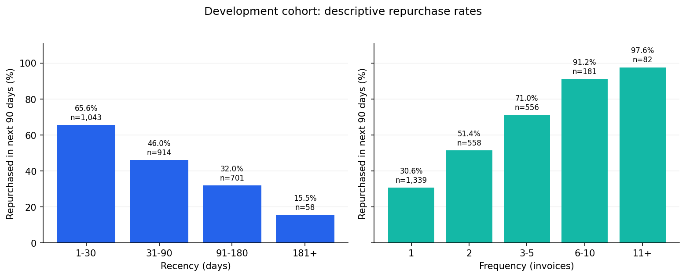

# Exploratory data analysis — Online Retail

Các hình dưới đây được tạo lại bằng `python scripts/build_eda_report.py` sau hai pipeline dữ liệu. **Kiểm tra chất lượng và chuỗi tháng** dùng toàn bộ nguồn để hiểu dữ liệu. **Quan hệ giữa RFM quá khứ và mua lại** chỉ dùng tập development: giao dịch trước 01/06/2011, kết quả trong `[2011-06-01, 2011-08-30)`. Không dùng outcome final để khám phá hay chọn model.

## 1. Chất lượng nguồn

Nguồn có **541,909** dòng; **135,080** dòng thiếu `CustomerID` (**24.9%**) nên không thể gán vào RFM cá nhân. Còn **391,074** dòng mua hàng hợp lệ (**72.2%**). Có **5,268** dòng trùng hoàn toàn. Các cờ loại trừ có thể chồng nhau nên không cộng riêng từng cờ để tính số dòng bị loại. Chi tiết nằm trong `data_cleaned/quality_report.json` khi chạy pipeline.

## 2. Hoạt động theo tháng

Tháng 11/2011 có **62,913** dòng mua hợp lệ và **£1,136,159** giá trị mua hàng, cao nhất trong các tháng đầy đủ của nguồn. Đây là biến động quan sát được, chưa đủ để kết luận mùa vụ lặp lại vì dữ liệu chỉ dài khoảng một năm. Tháng 12/2011 chỉ có đến ngày 09/12 nên không so trực tiếp với tháng đầy đủ.

## 3. Phân phối RFM trước khi tạo cụm

Tập development có **2,716** khách. Median `Recency/Frequency/Monetary` là **50 ngày / 2 hóa đơn / £464.13**. Có **49.3%** khách chỉ có một hóa đơn; **28 khách (~1%)** có Monetary cao nhất chiếm **27.5%** tổng Monetary quá khứ. Phân phối lệch mạnh nên feature dùng `log1p` trước khi fit `StandardScaler` trên development; các khách chi tiêu cao được giữ để kiểm tra độ nhạy, không xóa chỉ vì là ngoại lệ.

`Frequency` và `Monetary` có tương quan Spearman **0.74**; hai biến cùng mang tín hiệu về mức độ mua sắm. Điều này cần được lưu ý khi diễn giải khoảng cách và trọng số feature, nhưng chưa đủ lý do để bỏ một biến khỏi baseline chung của bốn model.

IQR trên giá trị gốc gắn cờ **195** khách có Frequency trên **6** hóa đơn và **259** khách có Monetary trên **£2,254.78**; Recency không có cờ phía cao. Trục boxplot được hiển thị log để nhìn được phần đuôi. Cờ ngoại lệ dùng để khảo sát độ nhạy, không phải nhãn gian lận hay quy tắc loại khách.

## 4. Quan hệ với mua lại 90 ngày trên development

**49.2%** khách development mua lại trong 90 ngày. Nhóm mua gần nhất trong 1–30 ngày có tỷ lệ **65.6%** (`n=1,043`), so với **15.5%** ở nhóm hơn 180 ngày (`n=58`). Theo Frequency, khách một hóa đơn mua lại **30.6%** (`n=1,339`), còn nhóm 11+ hóa đơn là **97.6%** (`n=82`). Nhóm nhỏ có tỷ lệ kém ổn định; đây là **liên hệ mô tả**, không phải hiệu quả nhân quả của việc chăm sóc khách.

## Kết luận cho bước modeling

- Chỉ dùng `data_cleaned/temporal/development/rfm_model_features.csv` để chọn feature và siêu tham số. Ba cột `_scaled` là đầu vào; `CustomerID` là khóa.
- Giữ `final` và outcome 90 ngày riêng cho đánh giá sau khi chốt cách làm. Việc Frequency và Monetary tương quan, cùng doanh thu tập trung ở ít khách, là lý do cần so model với quy tắc Monetary/RFM đơn giản ở cùng số khách được chọn.
- Chưa có nhãn cụm, nên EDA này **chưa** chứng minh có bao nhiêu cụm hay thuật toán nào tốt hơn. Xem [hướng dẫn bàn giao](../team_data_guide.md).
